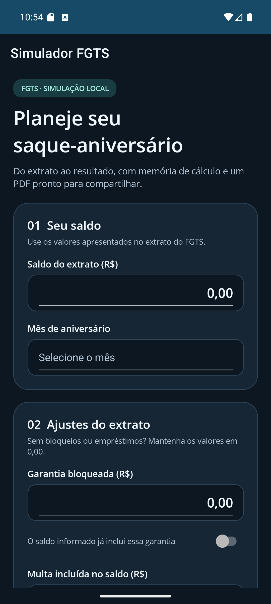
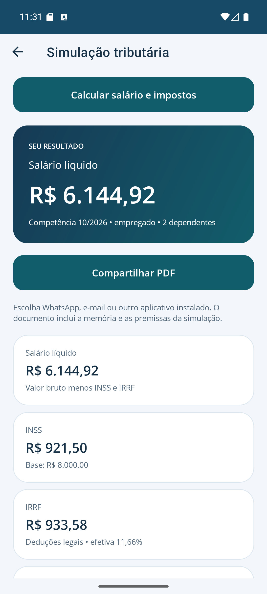

# Aplicativo móvel — .NET MAUI

## Escopo

O aplicativo Android é uma apresentação adicional para o mesmo núcleo de cálculo. A solução principal `CalculosTrabalhistasTributarios.sln` inclui os projetos desktop e móveis. O APK assinado é publicado no mesmo release do instalador do Windows, a cada tag de versão (veja [Publicação do APK](#publicação-do-apk)). Não há backend ou sincronização com o computador.

O menu lateral (☰) é montado a partir de `CatalogoCalculadorasMobile` (`Mobile.Presentation/Inicio`), com os grupos do WPF: Impostos e salário; Pensão e débitos judiciais; Remuneração e custos; Férias, 13º e desligamento; FGTS, afastamentos e benefícios. Cada item indica a calculadora e o formulário da tela comum de cálculo; o registro dos formulários no DI e a navegação partem desse catálogo, e um teste confere que cada valor de `TipoCalculadoraMobile` tem um único cartão. Cada abertura cria um formulário independente; voltar à tela inicial não salva um histórico.

No saque-aniversário, informe: saldo do extrato, garantia bloqueada, indicação de garantia já incluída, multa incluída, parcela anual comprometida e mês de aniversário. A seção **Nova antecipação** recebe a data da análise e as confirmações de carência de 90 dias, de contrato feito desde 01/11/2025 e de próximo saque já cedido, como no desktop. O resultado apresenta os destaques, proventos, descontos, total, memória e observações devolvidos pelo caso de uso existente.

O resultado pode ser compartilhado em PDF pelo menu nativo do Android (WhatsApp, e-mail e outros aplicativos compatíveis instalados). O documento contém destaques, verbas, total quando aplicável, comparativo, memória, observações e o aviso de simulação em todas as páginas. Não há exportação Excel no aplicativo móvel nem dependência de ClosedXML ou QuestPDF.

Como no desktop, as calculadoras e as tabelas ficam só no menu lateral; a tela inicial mostra as boas-vindas, um botão que abre o menu e, no fim, a assinatura com a versão instalada e o link do projeto, como o rodapé do desktop. O menu e a tela inicial permitem buscar calculadoras e tabelas por nome ou descrição; na tela inicial, os itens encontrados aparecem só durante a busca. A estrela ao lado de cada item, no menu ou nos resultados da busca, marca as favoritas, gravadas no aparelho. As tabelas locais podem ser consultadas, editadas, excluídas e atualizadas pela internet. A abertura prepara o banco e verifica as tabelas uma vez por dia quando essa opção está ligada; é possível pular a consulta. Em Configurações, há escolha do tema, atualização automática e o botão **Atualizar agora**. Falhas de rede preservam os dados locais.

O ícone, a tela de abertura e o logotipo usam a mesma arte do desktop (`CalculosTrabalhistasTributarios/Assets/logo-light.png` e `logo-dark.png`, reduzidas em `Resources/Images`), e as cores de `Resources/Styles/Colors.xaml` repetem a paleta do `ThemeManager`, nos temas claro e escuro. A tela inicial abre com as boas-vindas do desktop (`Features/Inicio/BoasVindasView`): quantidade de calculadoras e tabelas, data da última atualização, os cinco cálculos alterados mais recentemente em **Continuar de onde parou** e os primeiros passos; durante a busca, só os resultados ficam visíveis. O logotipo dependente do tema é definido em código (`Views/Logotipo`): um `AppThemeBinding` de `ImageSource` escrito no XAML fazia o compilador AOT do Android (mono-aot-cross 10.0.13) encerrar com corrupção de heap na compilação Release.

Como no desktop, cada calculadora tem **Preencher exemplo** (no menu ⋮ da barra), com os dados fictícios do manual: confirma a substituição, volta ao valor inicial todo campo que o exemplo não traz, desvincula o cálculo salvo que estava aberto e calcula. Os exemplos ficam em `Mobile.Presentation/Exemplos/Calculadora.{Tipo}.json`, com as chaves dos campos do formulário móvel e só o que difere do formulário vazio: texto preenche o valor, número escolhe a opção e verdadeiro ou falso marca o campo; grades e listas trazem as linhas completas (`ExemplosMobile`). **Ajuda** abre, dentro do aplicativo, a seção do manual da calculadora, pela mesma numeração do botão "?" do desktop (`SecoesDoManual`, compartilhado, e `ManualMobile`, que lê o `docs/MANUAL.md` embutido); o leitor de PDF do Android não abre o arquivo numa página, e o manual completo continua no botão ao fim da ajuda. As imagens do manual não aparecem nesse trecho. O histórico tem busca pelo nome ou pela calculadora (sem diferenciar acentos), filtros de calculadora e período e as ordens do desktop. `HistoricoMobileViewModel` controla busca com pausa de 300 ms, cancelamento de consultas substituídas, páginas de 20 resumos e seleção de dois cálculos entre páginas. `IConsultaHistoricoCalculos` consulta metadados no SQLite, sem trazer o JSON; abrir e comparar leem o formulário por ID. Os cinco recentes também usam essa consulta. A API antiga de histórico do desktop permanece compatível. Erros inesperados (exceções não tratadas, tarefas não observadas e as falhas que as telas registram com `LogError`) vão para `logs/erros-AAAA-MM.log` no armazenamento privado, pelo mesmo `ArquivoRegistroDeErros` do desktop; **Enviar registro de erros**, nas Configurações, compartilha o arquivo do mês pelo aplicativo que o usuário escolher. Na primeira abertura, o aviso de que os resultados são simulações aparece uma vez, como no desktop.

As transferências entre calculadoras seguem as do desktop: a quitação do banco de horas para o holerite ou a rescisão, a jornada pelo ponto para as horas extras ou o holerite, as diferenças do reajuste retroativo para o RRA e os depósitos da conferência do FGTS para a rescisão (`INavegacaoTransferenciasMobile`). A calculadora de destino abre preenchida, como uma calculadora nova. Não há exportação para o Excel. A rescisão permite digitar ou gerar os depósitos históricos de FGTS. Um formulário só fica guardado quando o usuário toca em **Salvar**. O aplicativo destinatário do compartilhamento gerencia o envio e sua conexão.

Essas calculadoras reutilizam a apuração e as tabelas locais do desktop. No **salário-família**, informe a remuneração do mês completo e os dias trabalhados; a remuneração de um mês parcial não deve ser proporcionalizada na entrada. Em **insalubridade e periculosidade**, escolha o grau e a base da insalubridade; o valor de base só aparece quando necessário. Em **comissões e DSR**, é possível usar o calendário da competência ou informar os dias do período. No **seguro-desemprego**, a solicitação define a janela de carência; o empregado doméstico usa o cálculo próprio da LC 150/2015.

O **Holerite do mês** organiza o formulário em seções (remuneração, horas e jornada, comissões e DSR, faltas, IRRF e pensão, benefícios e descontos) e usa a mesma apuração do desktop. Horas aceitam 10:30 ou 10,5. Comissões informadas no campo próprio recebem o DSR automaticamente, salvo se o valor já o incluir; não as repita nos proventos tributáveis. A quitação do banco de horas chega pelo botão do banco de horas.

No **Banco de horas**, escolha o regime (mesmo mês, até 6 meses ou até 1 ano), a situação e o período do ciclo, e registre cada crédito ou folga em linhas com data, tipo, horas de relógio (h:mm, até 10:00) e, no crédito, um adicional próprio opcional. O saldo é apurado em minutos e as folgas compensam primeiro os créditos mais antigos. No fechamento do ciclo, **Usar no holerite** abre o holerite da competência do fim do ciclo; na rescisão, **Usar na rescisão** abre a rescisão com o fim do ciclo como data de desligamento. Em ambos, o salário (e no holerite, o divisor) é copiado do banco, e o cálculo só considera a quitação depois que o usuário confirma as incidências de INSS, IRRF e FGTS; **Descartar quitação** remove as parcelas.

Em **Custo do funcionário**, escolha o regime, ajuste RAT/FAP quando aplicáveis e informe benefícios agregados ou benefícios detalhados em linhas com custo e participação do empregado; não duplique os valores. O custo por hora usa o divisor contratual informado. Em **Pró-labore e autônomo**, o campo ISS aparece somente para RPA quando houver retenção municipal. Em **PLR**, informe pagamentos e imposto já retido no ano; a pensão judicial opcional reduz a base do IRRF. Em **CLT x PJ**, o valor PJ igual a zero pede o cálculo da equivalência; o resultado e o PDF apresentam o comparativo anual, sem tratá-lo como um líquido único.

### Grades de linhas

Meses, vínculos, parcelas, aportes e marcações usam a grade comum da tela de cálculo (`GradeMobile`): cada linha tem os mesmos tipos de campo do formulário, **+ Linha** respeita o limite da calculadora e a remoção é imediata. **Gerar meses** cria as competências do período e preserva os valores já digitados; linhas fora do novo período continuam no fim da grade, com aviso, para o usuário removê-las. Os erros de leitura identificam a linha ("Mês 3: …") e levam a grade à página dessa linha. As linhas ficam na própria página, sem lista com rolagem interna, para que o gesto sobre elas role a tela inteira; por isso a grade mostra 12 linhas por vez, com **Anteriores** e **Próximas** acima e abaixo da faixa exibida ("13–24 de 60"), e **+ Linha** abre a página da linha nova. O cálculo sempre lê todas as linhas. Os depósitos históricos do FGTS da rescisão e os lançamentos do banco de horas seguem a mesma paginação. O resgate de previdência é a exceção: o gerador de aportes substitui a grade e pede um segundo toque de confirmação quando já existem aportes.

### Orientações por calculadora

- **Salário bruto pelo líquido, IRPF anual, carnê-leão, dividendos e ganho de capital:** usam as tabelas locais da competência ou do ano informado. O IRPF anual atende declarações a partir de 2026.
- **Contribuição do autônomo e do facultativo:** escolha a categoria e o plano (20%, 11% ou 5%); o resultado mostra código, vencimento e complementação quando aplicável.
- **Crédito do Trabalhador e empréstimo pessoal:** a margem livre vazia é diferente de zero. O empréstimo pessoal usa a tabela Price, com liberação entre 2025 e 2100.
- **Correção de valores, tributo em atraso, débitos judiciais, aposentadoria e pensão por morte:** dependem dos índices (IPCA, IPCA-E, INPC, Selic, TR, taxa legal) do banco local. Se uma fonte não confirmar o índice necessário, o caso de uso informa a ausência em vez de estimar um valor.
- **Abono salarial:** informe o ano-base, os meses trabalhados e a remuneração média; limite 0,00 usa o valor publicado.
- **Afastamentos e licenças:** informe tipo, início, remuneração e dias; um afastamento anterior pela mesma doença em 60 dias soma-se ao novo (Decreto 3.048/1999, art. 75).
- **INSS em múltiplos vínculos:** informe os vínculos na ordem de desconto; ela define quem usa cada faixa e o teto restante. Para mudar a ordem, remova e inclua a linha novamente.
- **Reajuste retroativo:** gere os meses com o salário anterior e o percentual, corrija os meses atípicos e acrescente 13º ou férias já pagos.
- **RRA:** gere os meses do pagamento e acrescente uma linha de 13º por ano; na Justiça Federal, rendimentos normais e dependentes não se aplicam.
- **Resgate de previdência:** prefira os saldos do extrato; o gerador apenas estima o saldo pela rentabilidade mensal.
- **Simples Nacional:** informe período e atividade e gere os meses da janela da RBT12/FS12.
- **Conferência do FGTS:** gere as competências, ajuste remuneração e depósito e, havendo desligamento, inclua uma linha do tipo Rescisória.
- **Gorjetas, sobreaviso e transferência:** gere os meses e preencha os valores de cada competência; horas de sobreaviso aceitam 10:30 ou 10,5. Na dispensa, informe os dias de aviso.
- **Média de verbas variáveis:** gere até 24 meses e confira o divisor; meses zerados também contam.
- **Trabalho no exterior:** **Consultar cotações oficiais** preenche, pela data de recebimento e pela moeda, o dólar compra fiscal e, quando disponível, a cotação USD por unidade (PTAX; 1 para dólar), com a mesma consulta do desktop (`ConsultaCotacoesTrabalhoExterior`, compilada no `Infrastructure.Tabelas`). Sem internet, digite esses valores. O câmbio efetivo e os encargos vêm sempre do comprovante bancário.
- **Aposentadoria e pensão por morte:** calcule a média pelos salários desde 07/1994 (um período por sequência de meses com o mesmo salário; **+ Período** começa no mês seguinte ao anterior) ou informe a média pronta. Na pensão, informe a aposentadoria recebida quando o segurado era aposentado.
- **Pensão alimentícia:** informe os rendimentos de quem paga e um beneficiário por linha, na ordem da decisão; o resultado segue a modalidade de IRRF de menor imposto e compara as duas. Para mudar a ordem, remova e inclua a linha novamente.
- **Pensão em atraso:** gere as parcelas do período, informe os pagamentos parciais e escolha correção, juros e acréscimos; o resultado separa o rito da prisão e o da penhora. Alterar valor, dia ou período faz o cálculo gerar as parcelas novamente, mantendo o valor pago de cada mês.
- **Estabilidade:** informe a média remuneratória, a demissão, o fim da estabilidade e, se houver, complementos. Como no desktop, o total estimado soma a indenização, o 13º, as férias com 1/3, o FGTS e a multa de 40%; uma observação no resultado explica essa soma.
- **Débitos judiciais:** escolha a natureza, a data do cálculo e as datas do processo (ajuizamento no trabalhista; citação no cível com juros desde a citação) e informe as parcelas com vencimento e valor.
- **Jornada pelo ponto:** informe competência, período do ponto (até 62 dias), escala e horário padrão, gere os dias e ajuste tipo e marcações. Os totais aparecem no quadro do resultado para serem digitados nas horas extras ou no holerite; mudar a escala não altera dias já gerados.

## Simulação tributária e tabelas locais

No menu ☰, abra **Simular impostos e salário**. Informe a competência em mm/aaaa, vínculo, valor bruto e dependentes. A base de INSS e FGTS segue o bruto por padrão; desligue essa opção para informar uma base diferente. Aposentadoria ou pensão usa base de INSS zero e permite informar 65 anos ou mais e 13º do benefício, como no WPF.

O resultado apresenta proventos, descontos, FGTS informativo, modalidades do IRRF e memória com as faixas. FGTS não reduz o líquido. O PDF inclui os valores exatos e considerados das faixas, preservando a explicação dos truncamentos. Valores e critérios vêm de `SimularImpostoUseCase`, sem nova fórmula na apresentação.

A biblioteca `Infrastructure.Local` contém a persistência extraída da Infrastructure original, com namespaces preservados para seus consumidores. Não referencia WPF, MAUI, QuestPDF ou ClosedXML. Ambos os aplicativos utilizam as mesmas consultas e sementes. O acesso interno concedido à Infrastructure desktop limita-se à reutilização dos helpers SQLite existentes pelos atualizadores.

O Android inclui o banco distribuído como recurso e copia-o uma única vez para `AppDataDirectory/BancoDados/calculoIrrf.db`, via arquivo temporário e renomeação atômica. Depois aplica o inicializador transacional e invalida o cache. Inicializações concorrentes são serializadas. Bancos existentes são preservados; uma falha permite nova tentativa. O trabalho SQLite é executado fora da thread de interface, pois o provedor possui operações síncronas internamente.

As tabelas distribuídas e suas sementes são consultadas pela competência informada; a política de vigência é a mesma do WPF. A manutenção e a atualização pelas fontes externas usam os serviços compartilhados de `Infrastructure.Tabelas`. Novas versões devem evoluir as sementes pelo procedimento existente, sem sobrescrever o banco privado. Não use bancos pessoais como recurso do pacote.

## Calculadoras trabalhistas

- **13º salário:** simula as duas parcelas ou o complemento das médias de dezembro, com adiantamento, pensão, previdência complementar, INSS e IRRF da competência informada.
- **Férias:** recebe dias de gozo e outros períodos, abono, adiantamento do 13º, início do descanso, fim concessivo e bases fora das férias por mês.
- **Horas extras:** aceita horas de relógio (`10:30`) ou decimais (`10,5`), duas faixas de adicional, horas noturnas urbanas ou rurais e feriados para o DSR.
- **Rescisão:** recebe motivo, vínculo, aviso, datas, verbas, descontos e depósitos históricos do FGTS em linhas editáveis. **Gerar meses do contrato** preserva valores já digitados para as competências geradas.

Todas usam os casos de uso compartilhados da Application e as tabelas locais da competência. Fora as transferências descritas acima, as entradas de uma calculadora não passam automaticamente para outra. O demonstrativo na tela e o PDF consomem a mesma apuração; FGTS aparece como informativo quando assim definido pelo caso de uso.

## Compartilhar PDF do saque-aniversário

1. Preencha o saldo, o mês de aniversário e os ajustes do extrato que se aplicarem.
2. Toque em **Calcular meu saque** e confira o valor estimado.
3. Use as expansões **Demonstrativo** e **Memória de cálculo** para consultar os detalhes na tela.
4. Toque em **Compartilhar PDF** e escolha o aplicativo e o destinatário. O envio só ocorre quando você o confirmar no aplicativo escolhido. Fechar o menu não indica falha nem comprova envio.

Editar uma entrada invalida o resultado e exige novo cálculo antes de compartilhar. Durante cálculo ou compartilhamento, os campos e comandos concorrentes ficam indisponíveis.

Os arquivos são gerados em `CacheDirectory/sharing-root`, com nomes exclusivos. O FileProvider expõe apenas essa subpasta. PDFs com mais de sete dias são removidos na próxima geração; o Android também pode limpar seu cache. O arquivo não é apagado ao fechar o menu, pois o destinatário pode ainda estar lendo o conteúdo. Não é solicitada permissão de acesso geral ao armazenamento.

O PDF usa `Android.Graphics.Pdf.PdfDocument`, sem serviços externos, com a mesma organização e aparência do demonstrativo do desktop (`RelatorioPdfDemonstrativo` e `ComponentesPdf`): cabeçalho com título e referência, resumo, comparativo, tabela de verbas com totais, barra do resultado, informativos, memória em molduras com o quadro de faixas, observações e o rodapé com o aviso de simulação, a versão e "Página X de Y". `DiagramacaoPdf` mede e distribui o conteúdo nas páginas antes de desenhar; tabelas que passam de página repetem o cabeçalho. Ao mudar o PDF do desktop, acompanhe a mudança no gerador móvel. O adaptador `ICompartilhamentoPdf` fica na apresentação móvel; geração e compartilhamento nativos ficam no projeto MAUI. O relatório consome o mesmo `DemonstrativoDto` exibido e não refaz cálculos. O texto obrigatório do rodapé é compartilhado com o desktop por `Application/Demonstrativos/AvisoSimulacao`.

## Preenchimento, rascunhos e resultados

- A tela comum organiza os campos pelas seções da calculadora. Toque no título para expandir ou recolher. **Calcular** permanece no rodapé; **Resultado** leva ao resumo depois de uma apuração. O menu **Ir ao resultado** também atende às calculadoras com página própria.
- Uma falha de leitura aparece junto ao campo, abre sua seção e posiciona o foco. Nas grades comuns, a página da linha inválida é exibida. Erros de regra que não identificam inequivocamente um campo continuam como mensagem geral; a interface não adivinha uma associação.
- Datas aceitam `dd/MM/yyyy` e competências `MM/yyyy`, com seleção assistida pelo ícone de calendário (**Escolher**). Ao sair do campo, oito dígitos de data ou seis de competência recebem os separadores; datas impossíveis continuam inválidas. Horas mantêm a unidade original: `1:30` e `1,5` são aceitos nas calculadoras que permitem ambos; `130` não é convertido automaticamente em `1:30`.
- As calculadoras guardam uma cópia automática do preenchimento a cada segundo, quando o conteúdo mudou, e solicitam gravação ao sair da página ou colocar o app em segundo plano. A cópia fica no armazenamento privado, separada do SQLite do histórico, com substituição atômica e limite de tamanho. Encerramento abrupto antes da gravação pode perder a última edição.
- Ao abrir novamente a calculadora, **Recuperar rascunho?** permite recuperar ou descartar. Recuperar não calcula nem altera históricos salvos. Abrir um histórico ou receber dados transferidos de outra calculadora tem precedência sobre esse aviso. Há um rascunho por calculadora, correspondente ao último preenchimento gravado.
- **Descartar rascunho**, no menu, pede confirmação, restaura os valores iniciais e apaga a cópia automática. **Salvar** continua criando ou atualizando explicitamente o histórico. Desinstalar o app apaga os dados locais; rascunho não substitui um histórico ou documento compartilhado.
- O resultado separa **Premissas e limites**, **Demonstrativo** e **Memória de cálculo** em expansões independentes. As premissas começam abertas. Os controles de cada expansão só são criados quando ela está aberta e são liberados ao recolher. Memória, comparativos e listas de verbas usam páginas; o cálculo e o PDF continuam consumindo o demonstrativo completo.

## Testes da interface Android

O CI compila o aplicativo Android e executa `tools/mobile-ui/smoke_android.py` em emulador API 36. O APK Release, com AOT desativado apenas para reduzir o tempo de compilação dos testes, usa o identificador terminado em `.uitests`, separado da instalação normal. O script recusa depender de um pacote de produção e limpa somente os dados do pacote de testes. Ele verifica busca, exemplo de férias, expansão do resultado, foco em data inválida, recuperação após encerramento do processo, descarte, tema escuro, largura de aproximadamente 320 DIPs e fonte ampliada. Evidências e logcat são publicados pelo job, inclusive em falha.

Para executar localmente, com SDK, JDK, workload Android e emulador disponíveis:

```powershell
dotnet build CalculosTrabalhistasTributarios.Mobile -c Release -p:ApplicationId=br.com.mayconwisley.calculostrabalhistastributarios.uitests -p:EmbedAssembliesIntoApk=true -p:AndroidPackageFormats=apk -p:RuntimeIdentifier=android-x64 -p:RunAOTCompilation=false
python tools/mobile-ui/smoke_android.py --apk CalculosTrabalhistasTributarios.Mobile/bin/Release/net10.0-android/android-x64/br.com.mayconwisley.calculostrabalhistastributarios.uitests-Signed.apk
```

Use `--adb` para informar o executável e `--serial` quando houver mais de um aparelho conectado. `--artifacts` define o diretório das evidências. O script altera temporariamente tamanho, densidade, fonte e tema do emulador; execute em um emulador dedicado a testes. Esses testes não comprovam envio de PDF a destinatários nem comportamento em todos os fabricantes.

## Aparência e validação

A tela separa saldo e ajustes em cartões, destaca o resultado e permite expandir demonstrativo e memória. Os temas acompanham a preferência do sistema.

<p> </p>

Conferência realizada em emulador Android x86_64 com densidade de 420 dpi, em 1080 × 2400 e 840 × 1680 pixels (aproximadamente 411 × 914 e 320 × 640 DIPs), nos temas claro e escuro. Foram verificados preenchimento, seleção de mês, rolagem, resultado, expansão dos detalhes e abertura do menu nativo com o PDF anexado. O exemplo de saldo R$ 8.000,00 produziu resultado de R$ 2.250,00 e PDF de duas páginas, ambas renderizadas e inspecionadas. Não houve envio a destinatários; WhatsApp não estava instalado no emulador. Isso não substitui a validação de distribuição Release e envio em aparelho físico.


<p>  </p>

Na simulação tributária, foram conferidos catálogo, navegação, primeira preparação do SQLite e cálculo de outubro de 2026 com bruto de R$ 8.000,00 e dois dependentes: INSS R$ 921,50, IRRF R$ 933,58, líquido R$ 6.144,92 e FGTS informativo de R$ 640,00. O comparativo foi verificado também em 320 × 640 DIPs no tema escuro. Os testes de paridade usam competências históricas e os quatro vínculos. O compartilhamento foi conferido até o menu com o PDF anexado, sem envio a destinatários.

Na ampliação trabalhista, as quatro telas foram abertas no emulador. A rescisão foi conferida com edição do salário, adição e remoção de linha de FGTS e cálculo com resultado exibido. O formulário e a lista de FGTS foram inspecionados em 1080 × 2400 no tema claro e em 840 × 1680 no tema escuro. O PDF das novas calculadoras não foi inspecionado visualmente em aparelho físico.

Com o PDF no formato do desktop, o emulador (1080 × 2400) gerou os relatórios da simulação tributária (6 páginas) e da rescisão (7 páginas). As páginas foram renderizadas e inspecionadas: cabeçalho, resumo, tabela de verbas com totais, barra do resultado, molduras da memória divididas entre páginas sem invadir o rodapé, títulos de fórmula mantidos com a primeira linha e o rodapé com o aviso e "Página X de Y". O PDF não foi aberto em aparelho físico.

Na ampliação para todas as calculadoras, a conferência no emulador Android (API 36, 1080 × 2400, 420 dpi, tema claro) abriu cada tela nova pelo catálogo e acionou **Calcular** com os valores iniciais; todas exibiram a mensagem de validação esperada ou um resultado. Com dados, foram conferidos: gorjetas (Gerar meses com 12 linhas, R$ 1.500,00 em um mês: média R$ 125,00, total R$ 1.791,67 e FGTS R$ 143,33), jornada pelo ponto (geração dos dias e 196:00 horas em 10/2026) e correção de valores pelo IPCA de 01/2025 a 01/2026 (R$ 1.000,00 para R$ 1.042,64). O PDF da jornada chegou ao menu nativo de compartilhamento, sem envio e sem inspeção visual das páginas. Datas, competências, horas e textos usam o teclado de texto, porque o estilo padrão das entradas é numérico e descartaria "/", ":" e letras. Depois da troca das listas com rolagem própria pela grade paginada, o gesto sobre as linhas passou a rolar a página; na compilação Release, gerar 720 competências na conferência do FGTS levou cerca de 3 s, contra cerca de 5 s para 60 linhas exibidas todas de uma vez, e **Próximas** no paginador inferior levou a tela ao início da página seguinte.

Na ampliação da navegação, foram conferidos no emulador o progresso e o botão **Pular** na abertura, o catálogo, o menu lateral, Configurações e a leitura dos registros locais da Tabela INSS. A tela inicial foi inspecionada em 1080 × 2400 no tema claro e 840 × 1680 no tema escuro; os testes automatizados cobrem a busca, as favoritas, a política diária de atualização e a edição da tabela com uma fonte simulada. Depois, na compilação Release instalada do zero (1080 × 2400, temas claro e escuro), a abertura atualizou as 13 tabelas pela internet; **Atualizar agora** mostrou o progresso por tabela e **Cancelar**; o menu abriu a Tabela INSS, cuja seleção de faixa leva a tela ao formulário preenchido; o Histórico vazio e o Manual no leitor de PDF do aparelho também foram abertos. Não foram conferidos salvar, excluir e comparar históricos nem a gravação de registros editados na tabela. Com o ícone, a paleta e as boas-vindas, a compilação Release mostrou o logotipo no lançador e na abertura; um cálculo salvo apareceu em Continuar de onde parou e reabriu calculado, nos temas claro e escuro. Com exemplo, ajuda, filtros, registro de erros e aviso, a compilação Release no emulador (1080 × 2400, tema claro) mostrou o aviso na primeira abertura; em Férias, **Preencher exemplo** preencheu e calculou o exemplo do manual, e **Ajuda** abriu a seção 8.4; o histórico encontrou "Férias" pela busca "ferias"; e **Enviar registro de erros**, sem erros no mês, informou que não há registro. Os testes conferem que os 50 exemplos calculam sem mensagem de erro, mas não comparam seus valores com os destaques do desktop; o tema escuro, os filtros de período e ordem na tela e o compartilhamento de um registro existente não foram conferidos no emulador.

## Estrutura e dependências

```text
CalculosTrabalhistasTributarios.Mobile.sln
├── Domain                         # regras existentes, independentes de interface
├── Application                    # casos de uso e contratos existentes
├── Infrastructure.Local           # SQLite e sementes compartilhados, sem bibliotecas de relatório
├── Infrastructure.Tabelas          # manutenção e fontes de atualização compartilhadas
├── Mobile.Presentation            # net10.0: ViewModels por funcionalidade, sem MAUI/WPF
│   ├── DependencyInjection.cs
│   ├── Interfaces/                  # portas da plataforma (PDF, navegação, histórico, preferências)
│   ├── SaqueAniversario/
│   ├── Inicio/                      # catálogos, busca e favoritas
│   ├── Abertura/ e Configuracoes/   # atualização diária e preferências
│   ├── Tabelas/                     # edição e consulta por competência
│   ├── Tributacao/                  # simulação tributária
│   ├── Trabalhista/                 # formulários da tela comum, campos e grades
│   ├── Historico/                   # cálculos salvos, filtros e comparação
│   ├── Exemplos/                    # Preencher exemplo, um JSON por calculadora
│   └── Ajuda/                       # seção do manual de cada calculadora
├── Mobile                         # net10.0-android: composição e controles nativos
│   ├── MauiProgram.cs
│   ├── App.xaml
│   ├── Comportamentos/
│   ├── Features/                    # páginas: Inicio, Abertura, Configuracoes, Tabelas, Tributacao,
│   │                                #   Trabalhista (tela comum), SaqueAniversario, Historico e Ajuda
│   ├── Services/                    # PDF, histórico, manual, navegação, preferências e registro de erros
│   ├── Views/                       # logotipo, paginador das grades e resultado
│   ├── Platforms/Android/           # Reporting/: DiagramacaoPdf e GeradorDemonstrativoPdf
│   └── Resources/
└── Mobile.Tests                   # net10.0: testes sem dispositivo ou workload MAUI
```

Fluxo: página → binding/command do ViewModel → `ISimularDemonstrativoUseCase<TRequest>` → domínio → `DemonstrativoDto` → página.

- `MauiProgram` é o ponto de composição. Registra `AddCalculadoras`, `AddSaqueAniversario`, `AddAtualizacaoTodasTabelas`, `AddInfrastructureLocal`, `AddAtualizacaoTabelas` e `AddPresentation`. A atualização compartilha fontes e critérios com o desktop.
- `AberturaPage` prepara o SQLite antes da navegação e mostra progresso ou falha; `FlyoutPage` mantém o menu lateral, a busca e as favoritas da mesma janela. As preferências ficam no armazenamento privado do Android. O manifesto declara acesso à internet para atualizar tabelas e abrir a fonte oficial.
- Calculadoras com resultado próprio no desktop (estabilidade, pensão alimentícia, pensão em atraso, débitos judiciais, jornada) são apresentadas pelos montadores de `Application/Demonstrativos`, que reorganizam o resultado apurado em `DemonstrativoDto` sem recalcular.
- Cada janela possui um escopo de DI, descartado em `Window.Destroying`. Página e ViewModel são transient; não compartilhe formulários mutáveis em singletons.
- `Mobile.Presentation` usa CommunityToolkit.Mvvm para notificações e comandos assíncronos. Não depende de controles MAUI, WPF ou Infrastructure.
- `LeituraNumerica.cs` e `LeituraDeHoras.cs` são incluídos como fontes vinculadas da apresentação existente, assim como `SecoesDoManual.cs` e a comparação de resultados do histórico; o projeto Mobile vincula `ArquivoRegistroDeErros.cs`, da Infrastructure, e o `Infrastructure.Tabelas`, a consulta de cotações do trabalho no exterior. Há uma única implementação do parser, sem carregar o assembly WPF. Ao alterá-lo, execute os testes de ambas as apresentações. Se mais componentes independentes precisarem ser compartilhados, avalie uma biblioteca comum de apresentação, sem mover parsing de formulário para o domínio.
- Os bindings são tipados com `x:DataType`; mantenha a compilação XAML estrita. Textos e valores usam `pt-BR`; cores acompanham o tema do sistema.
- O comando impede execução simultânea e recebe `CancellationToken`. A saída da página cancela a operação. Editar uma entrada invalida o resultado exibido.
- Falhas esperadas usam o `Result` existente. Falhas inesperadas na fronteira de apresentação são registradas com `ILogger`, sem formulário completo, e produzem mensagem ao usuário. O `RegistroDeErrosLoggerProvider` grava os erros no log mensal do armazenamento privado (`ArquivoRegistroDeErros`, o mesmo do desktop); o provedor Debug só se soma a ele nas compilações de depuração.

## Preparação e execução

Requisitos: .NET SDK 10 compatível com `global.json`, workload MAUI Android, Android SDK, JDK compatível e emulador ou aparelho Android com depuração USB. O alvo mínimo configurado é Android 7/API 24. Para uma instalação de desenvolvimento, use o Visual Studio Installer ou restaure os workloads:

```powershell
dotnet workload restore .\CalculosTrabalhistasTributarios.Mobile\CalculosTrabalhistasTributarios.Mobile.csproj
dotnet restore .\CalculosTrabalhistasTributarios.Mobile.sln
dotnet build .\CalculosTrabalhistasTributarios.Mobile.sln -c Debug --no-restore
dotnet test .\CalculosTrabalhistasTributarios.Mobile.Tests\CalculosTrabalhistasTributarios.Mobile.Tests.csproj
```

Abra a solução principal ou a solução móvel no Visual Studio, selecione o projeto Mobile como inicialização e escolha o aparelho/emulador. Se a solução já estava aberta durante a inclusão dos projetos, aceite seu recarregamento ou feche e abra novamente o arquivo `.sln`. Com um destino Android disponível, também é possível executar:

```powershell
dotnet build .\CalculosTrabalhistasTributarios.Mobile\CalculosTrabalhistasTributarios.Mobile.csproj -t:Run -f net10.0-android
```

Os testes de apresentação podem rodar sem Android SDK. Para compilar somente o desktop sem workloads móveis, use `dotnet build .\CalculosTrabalhistasTributarios.Desktop.slnf`, como no README e no CI. A compilação da solução principal completa exige também o ambiente MAUI Android.

## Publicação do APK

O APK é publicado no mesmo release do instalador do Windows, ao enviar a tag `vX.Y.Z` (veja "Publicar uma nova versão" no README). `instalador\gerar-apk.ps1` roda os testes do mobile e publica o projeto em Release com a versão da tag; o código de versão do Android é calculado dela (maior × 10000 + menor × 100 + correção; `v1.20.0` vira `12000`), por isso cada tag precisa ser maior que a anterior. Os valores de `ApplicationDisplayVersion` e `ApplicationVersion` no `.csproj` valem só para as compilações locais.

O Android só aceita uma atualização assinada com a mesma chave da versão instalada. Com outra chave, o usuário precisa desinstalar o app e perde os cálculos salvos e as tabelas editadas. Crie a chave uma única vez, guarde o arquivo e a senha com cópia de segurança e nunca a coloque no repositório:

```powershell
New-Item -ItemType Directory -Force "$env:USERPROFILE\chaves"
& "C:\Program Files\Android\openjdk\jdk-21.0.8\bin\keytool.exe" -genkeypair -v -keystore "$env:USERPROFILE\chaves\calculadora-android.keystore" -alias calculadora -keyalg RSA -keysize 2048 -validity 10000
```

O `keytool` pede a senha e os dados do certificado; ele acompanha o JDK instalado com o Android SDK. Depois, informe a chave em variáveis de ambiente do usuário e abra um terminal novo:

```powershell
[Environment]::SetEnvironmentVariable('CALCULADORA_ANDROID_KEYSTORE', "$env:USERPROFILE\chaves\calculadora-android.keystore", 'User')
[Environment]::SetEnvironmentVariable('CALCULADORA_ANDROID_ALIAS', 'calculadora', 'User')
[Environment]::SetEnvironmentVariable('CALCULADORA_ANDROID_SENHA', '<senha da chave>', 'User')
```

A senha segue para o MSBuild pelo prefixo `env:`, sem aparecer na linha de comando nem no log; ela fica, porém, gravada nas variáveis do usuário do Windows. Para gerar só o APK, sem publicar: `.\instalador\gerar-apk.ps1 -Versao 1.20.0`. O arquivo sai em `artefatos\CalculosTrabalhistasTributarios-<versão>-android.apk`.

Os APKs gerados antes da chave de publicação, nos testes e no emulador, foram assinados com a chave de depuração do SDK. Um aparelho com um deles precisa desinstalar o app antes de instalar o APK publicado.

## Regras para ampliar

1. Reutilize ou implemente o caso de uso na Application, com regras exclusivamente no Domain. Não copie fórmulas para ViewModels ou XAML.
2. Registre a funcionalidade na camada responsável. Casos de uso de cálculo entram em `AddCalculadoras`. Não chame `AddApplication` completo no móvel enquanto suas portas de infraestrutura não estiverem implementadas; a atualização de tabelas exige fontes e consultas externas.
3. Para a tela comum, derive de `CalculadoraTrabalhistaViewModel` em `Mobile.Presentation/Trabalhista`, acrescente o valor a `TipoCalculadoraMobile` e o cartão a `CatalogoCalculadorasMobile`; registro e navegação seguem o catálogo; crie também `Mobile.Presentation/Exemplos/Calculadora.{Tipo}.json` e confira a seção do manual (`ExemplosMobileTests` e `ManualMobileTests` cobram os dois). Uma página própria fica em `Mobile/Features/<Funcionalidade>`, com cartão sem formulário e entrada na fábrica de páginas do `MauiProgram`. Mantenha code-behind limitado ao ciclo de vida e comportamento visual.
4. Crie portas novas somente para necessidades reais e coloque interfaces em `Interfaces` da camada responsável. Não crie novos projetos Domain ou Application exclusivos do celular.
5. Para SQLite, adapte o caminho ao armazenamento privado (`FileSystem.AppDataDirectory`), inicialize em local gravável e preserve sementes, transações e compatibilidade. Não referencie a Infrastructure inteira apenas para usar um serviço: primeiro valide e separe as dependências incompatíveis.
6. Ao ampliar o relatório móvel para outra calculadora, inclua explicitamente quadros, comparativos ou outros dados especializados do DTO: o gerador consome destaques, verbas, informativos, memória, quadros de faixas e comparação de modalidades do IRRF. Preserve o aviso em cada página, os valores da tela e a quebra de textos longos. Valide PDF renderizado, compartilhamento, trimming e execução Release em aparelhos.
7. Para iOS, acrescente alvo, inicializadores e recursos da plataforma em uma etapa própria, com compilação no Mac, assinatura e verificação real. iOS e Windows MAUI não estão configurados nesta base.
8. Cubra mapeamento de entradas, validações, falhas e ciclo de vida dos comandos. Verifique no dispositivo temas claro/escuro, teclado, rolagem, fonte ampliada, valores grandes e orientação. Compilação não comprova usabilidade.
9. Mantenha a thread da tela livre: SQLite e outras operações síncronas rodam com `Task.Run`, e uma seção escondida por `IsVisible` não recebe a lista completa em `BindableLayout.ItemsSource`, porque os itens seriam criados mesmo sem aparecer (a tela inicial usa `GrupoAtalhosMobile.ItensBusca`, vazia fora da busca). Para só ler ou recalcular um formulário, resolva o ViewModel pela fábrica de formulários do `MauiProgram`, sem montar a página.
10. O aplicativo já é distribuído com o identificador `br.com.mayconwisley.calculostrabalhistastributarios` e a chave de publicação descrita acima. Alterar qualquer um dos dois impede a atualização sobre a versão instalada e faz o usuário perder os cálculos salvos; não os mude sem planejar a continuidade dos dados.

## Contratos de interação e persistência

- Os três tipos de formulário implementam `IFormularioEditavelMobile`: só mudanças dos dados persistidos disparam `FormularioAlterado`, inclusive linhas adicionadas, removidas ou importadas. Mudanças de mensagem, foco e resultado não marcam rascunho.
- `ControleRascunhoFormulario` serializa preparação, descarte e gravação; a confirmação de recuperação ocorre uma única vez por página. O estado é exportado no contexto da UI somente quando houve edição; a serialização JSON das cópias roda fora dela, após 750 ms de pausa. Sair ou colocar o app em segundo plano solicita gravação imediata. Uma edição durante a escrita permanece pendente para a próxima gravação.
- `NavegacaoTecladoFormulario` usa a ordem atual das entradas de texto na árvore visual; ignora ancestrais ocultos, desabilitados ou transparentes ao toque. Reavalia a sequência ao expandir seções, alterar visibilidade ou incluir linhas. A última entrada usa Concluir e fecha o teclado, sem calcular implicitamente.
- A limpeza de PDFs antigos é oportunista: falhas esperadas de acesso ficam contabilizadas no diagnóstico e não interrompem a geração. Cancelamento continua sendo propagado; a falha de criação do novo documento permanece um erro de exportação.

## Referências

- [Injeção de dependências no MAUI](https://learn.microsoft.com/en-us/dotnet/maui/fundamentals/dependency-injection?view=net-maui-10.0)
- [Plataformas suportadas](https://learn.microsoft.com/en-us/dotnet/maui/supported-platforms?view=net-maui-10.0)
- [Bindings compilados](https://learn.microsoft.com/en-us/dotnet/maui/fundamentals/data-binding/compiled-bindings?view=net-maui-10.0)
- [Compartilhamento de arquivos e configuração do FileProvider](https://learn.microsoft.com/en-us/dotnet/maui/platform-integration/data/share?view=net-maui-10.0)
- [PDF nativo do Android](https://developer.android.com/reference/android/graphics/pdf/PdfDocument)

## Validação anterior à revisão (24/10/2026)

Foram aprovados 206 testes móveis e 993 testes desktop. O APK Android Release isolado foi compilado, com 15 avisos XC0025 em bindings com Source explícito. O manual PDF foi regenerado e as páginas afetadas foram conferidas visualmente.

O percurso ADB/UIAutomator está configurado no CI, mas não foi concluído localmente: os emuladores API 36 apresentaram ANR de componentes do próprio Android (System UI e Process system), inclusive antes da abertura do aplicativo. Assim, temas, fonte ampliada, foco, calendários, recuperação após encerramento e compartilhamento de PDF ainda exigem aprovação por navegação real em dispositivo ou emulador estável. Compilação e testes de apresentação não substituem essa conferência.

## Validação da revisão (24/10/2026)

- 222 testes móveis e 993 testes desktop aprovados. As novas regressões cobrem consulta SQLite paginada sem JSON, busca sem acentos, limites, cancelamento, consultas substituídas, estados/comandos do histórico, recuperação concorrente, edição durante gravação/descarte e limpeza parcial do cache.
- APK Android Release compilado com o identificador isolado `.uitests`, x64 e AOT desabilitado para o emulador: zero erros. A compilação completa emitiu 18 avisos XC0025 de bindings com Source explícito; a última compilação incremental terminou sem avisos. Isso não valida a publicação com AOT.
- Manual PDF regenerado, com conferência visual das páginas 4 e 5.
- Foi possível abrir e conferir o formulário de férias em tema claro, 1080x2400 e 420 dpi (aproximadamente 411 DIPs de largura), com valores iniciais. A automação foi corrigida para confirmar o exemplo e aceitar o diálogo de recuperação antes de buscar o botão Calcular; foram acrescentados os percursos de teclado e compartilhamento.
- A execução completa do APK final não foi aprovada: as tentativas registraram ANRs do Process system, do launcher Nexus e da inicialização do pacote de testes. A causa não foi isolada. Ainda faltam a navegação completa do histórico e a conferência de teclado, calendários, recuperação, fonte ampliada, tema escuro e PDF em dispositivo estável. O CI remoto não foi executado nesta sessão.

O relatório de ANR foi coletado por ADB. Nas três ocorrências recentes de timeout de foco, a pilha nativa do app foi obtida aproximadamente dez segundos depois e mostrou a thread principal aguardando no Looper (`__epoll_pwait`/`MessageQueue.nativePollOnce`). Essa amostra tardia não identifica o bloqueio original nem permite atribuir a causa com segurança. A opção de diagnóstico `--reuse-installed` retoma exclusivamente o pacote `.uitests` sem limpar dados; o CI continua usando instalação e limpeza completas.
